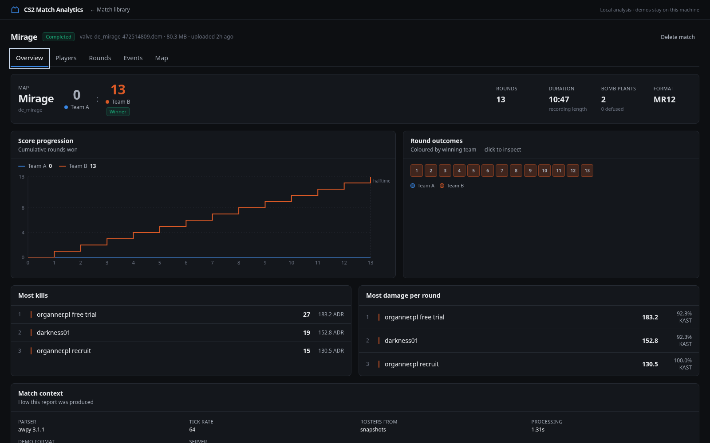

# CS2 Match Analytics

Post-match analytics for Counter-Strike 2 demos. Upload a `.dem` file, and the server
parses it locally and produces an interactive match report: per-player statistics, a
round-by-round breakdown with event timelines, a searchable event table, and kill and
death positions plotted on the real map radar.

Everything runs on your machine. Demos are never transmitted anywhere.



## What it does

- **Parses real CS2 demos** with [awpy](https://github.com/pnxenopoulos/awpy) 3.x — which
  reconstructs rounds from game state, so it works on Valve matchmaking demos that contain
  no `round_start` / `round_end` events at all.
- **Computes statistics independently** of the parser's own aggregation, each with a
  published definition: K/D/A, K/D, KPR, ADR, headshot %, KAST, opening duels, trades,
  multi-kills, clutches and utility. Verified to match both the parser **and** a published
  third-party scoreboard on a real match.
- **Never shows a guess as a fact.** A metric the demo cannot support renders as an em dash
  with the reason, never as `0`. There is deliberately no "HLTV Rating".
- **Tells failure apart from emptiness.** A corrupt demo, a CS:GO demo and a valid demo
  containing no rounds each get their own explanation.

## Requirements

- **Python 3.11+** (developed and verified on 3.14)
- **Node.js 20+** (verified on 22)
- Linux, macOS or Windows x86-64/arm64 — all dependencies ship prebuilt wheels, so no Rust
  or C compiler is needed.

## Setup

```bash
make setup          # backend venv + pinned deps, frontend npm ci
```

Or by hand:

```bash
cd backend && python3 -m venv .venv && .venv/bin/pip install -r requirements.lock
cd ../frontend && npm ci
```

Configuration is optional — every setting has a working default. Copy `.env.example` to
`.env` to change any of them.

## Running

Two terminals in development:

```bash
make dev-backend    # http://127.0.0.1:8000  (API + docs at /api/docs)
make dev-frontend   # http://127.0.0.1:5173  (proxies /api to the backend)
```

Open **http://127.0.0.1:5173** and drag a `.dem` file onto the page.

Single-origin production mode, where the API also serves the built frontend:

```bash
make build
make run            # http://127.0.0.1:8000
```

## Command line

The parser and the statistics work with no server and no database, which is the fastest
way to check a demo or debug a number:

```bash
cd backend
.venv/bin/python -m app.cli analyze /path/to/match.dem      # scoreboard, straight to stdout
.venv/bin/python -m app.cli analyze /path/to/match.dem --json
.venv/bin/python -m app.cli probe   /path/to/match.dem      # dump everything the parser returns
.venv/bin/python -m app.cli ingest  /path/to/match.dem      # parse and store, as the server would
.venv/bin/python -m app.cli fetch-fixture --list            # public test demos
.venv/bin/python -m app.cli warm-maps                       # pre-download radar images
```

```
  de_mirage   Team A 0 - 13 Team B
  13 scored rounds   tick rate 64 (header)   parsed in 1.59s
  parser awpy 3.1.1   rosters from snapshots

  player                   T    K    D   A    K/D     ADR    HS%   KAST   OK   OD   TD    UD   EF
  -----------------------------------------------------------------------------------------------
  organner.pl free trial   B   27    1   2  27.00   183.2   40.7   92.3    2    0    0   555    7
  darkness01               B   19    5   4   3.80   152.8   63.2   92.3    7    0    3   522    0
  ...
  TipoYaSkrr               B    0    1   0   0.00     0.0      —   92.3    0    0    0     0    3
```

## Testing

```bash
make test           # backend unit + API tests, then frontend tests
make lint           # ruff, mypy --strict, eslint, tsc
```

Backend tests split three ways:

```bash
cd backend
.venv/bin/python -m pytest tests/unit tests/api -q     # fast, no demo needed
.venv/bin/python -m pytest -m fixture_demo -q          # against a real 84 MB demo
```

The real-demo tests **skip** unless the fixture is present — they never download it
implicitly. To fetch it (84 MB, checksum-verified, gitignored):

```bash
.venv/bin/python -m app.cli fetch-fixture
```

`fetch-fixture` without `--name` takes the smallest. **The integration suite is
parameterized over whatever fixtures are present**, so downloading another extends
coverage without touching a test:

| Fixture | Size | What it adds |
|---|---|---|
| `valve-de_mirage-472514809` | 84 MB | 13–0, one side swap, csstats.gg scoreboard |
| `faceit-de_mirage-6de46e85` | 438 MB | **Overtime** (16–14, swaps at 13 and 28), pre-match knife round |
| `esea-de_dust2-2c5bdd12` | 408 MB | **Second map** (validates the de_dust2 radar transform), a **coach** who never spawns, blind-derived flash assists |

Each fixture's manifest carries a published scoreboard, so the integration test checks our
numbers against **two independent oracles**: the parser's own aggregation (exact match
required) and the platform's own scoreboard (per-metric tolerances, with every divergence
documented rather than absorbed).

There is also a real-browser smoke test that uploads a demo through the UI and walks every
tab, failing on a console error or a missing element:

```bash
make run &                                             # or dev-backend + dev-frontend
cd frontend && npm run verify:ui -- http://127.0.0.1:8000 ../data/fixtures/*.dem
```

## API

Interactive documentation at `/api/docs` when the server is running.

| Endpoint | Purpose |
|---|---|
| `POST /api/matches` | Upload a demo as a raw `application/octet-stream` body |
| `POST /api/matches/import` | Import from a public URL (SSRF-guarded) |
| `GET /api/matches` | List, filter and paginate matches |
| `GET /api/matches/{id}` | Metadata, status, stage, dataset availability, anomalies |
| `GET /api/matches/{id}/players` | Scoreboard |
| `GET /api/matches/{id}/rounds` | Round summaries with per-player rows |
| `GET /api/matches/{id}/events` | Filtered, sorted, paginated event feed |
| `GET /api/matches/{id}/weapons`, `/events/count` | Values to populate the filters |
| `DELETE /api/matches/{id}` | Delete the match, its analytics and its demo file |
| `GET /api/maps/{map}`, `/radar.png` | Radar image and coordinate transform |
| `GET /api/metrics` | **Every metric's definition** — drives the UI's tooltips |
| `GET /api/health` | Status, queue depth, capacity, parser version |

Uploads are a raw body rather than multipart on purpose: a multipart handler only runs
after the framework has already spooled the whole body to disk, so the size cap could be
reported but not enforced. Example:

```bash
curl -X POST "http://127.0.0.1:8000/api/matches?filename=match.dem" \
     -H 'Content-Type: application/octet-stream' \
     --data-binary @match.dem
```

Every error — validation included — uses one envelope, so clients branch on a stable code:

```json
{"error": {"code": "source1_demo",
           "message": "This is a CS:GO (Source 1) demo. Only Counter-Strike 2 demos are supported."}}
```

## Documentation

| Document | Contents |
|---|---|
| [docs/METRICS.md](docs/METRICS.md) | Every metric's definition, denominator and caveats; known limitations |
| [docs/ARCHITECTURE.md](docs/ARCHITECTURE.md) | Layers, the normalized model, why the worker is a subprocess |
| [docs/PRIVACY.md](docs/PRIVACY.md) | What demos contain, storage, deletion, threat model, SSRF guards |
| [docs/ROADMAP.md](docs/ROADMAP.md) | Behavioural analytics, LLM analysis, wearables, training plans |
| [docs/awpy-probe.md](docs/awpy-probe.md) | Observed parser output, and the decisions taken from it |

## Privacy and security in one paragraph

Demos contain real player names, Steam IDs and positions. Nothing leaves your machine.
Deleting a match removes its analytics **and** the stored `.dem`. The server binds to
localhost and has **no authentication** — it is a single-user local tool, and exposing it
to a network requires adding authentication and authorization first. See
[docs/PRIVACY.md](docs/PRIVACY.md).

## Known limitations

- Overtime, side swaps, a second map, a never-spawning coach and pre-match knife rounds
  are all covered by real demos. A knife round recorded *inside* the round table (rather
  than before round 1) is still **synthetic-fixture-only** — none of the three published
  fixtures contains one.
- Kills and damage use different weapon names for the same gun (the R8's damage is reported
  as `deagle`, its kills as `revolver`). No statistic depends on this; the event table
  shows what the demo said.
- Spatial plots ignore the `rotate`/`zoom` fields a few maps declare, matching the
  reference implementation. Verified on de_mirage, where they are the identity.
- Multi-part demos are not supported.

A full list, with reasoning, is in [docs/METRICS.md](docs/METRICS.md#known-limitations).

## License and attribution

Parsing is done by [awpy](https://github.com/pnxenopoulos/awpy) (MIT). Map radar images and
coordinate tables come from [awpy-data](https://github.com/pnxenopoulos/awpy-data) and are
downloaded on demand into your data directory; they are Valve-derived assets and are not
redistributed by this project. Counter-Strike is a trademark of Valve Corporation; this
project is not affiliated with Valve.
